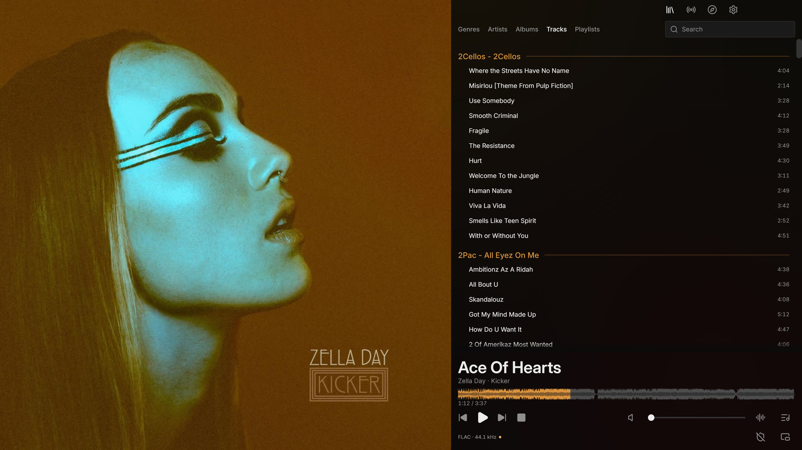
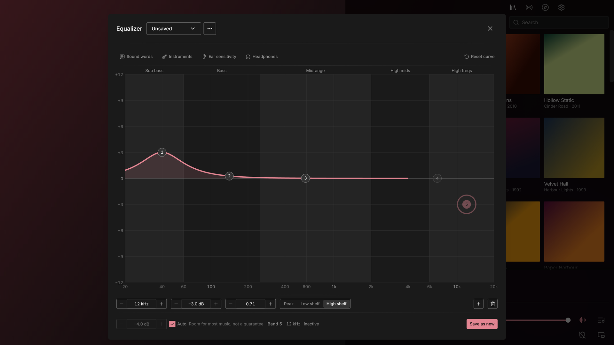

# Music Player

[](https://github.com/Levan-D/music-player/actions/workflows/ci.yml)

A desktop music player for Windows, for the music library you already own: a folder of FLAC and MP3 files on your own disk. Point it at the folder and it becomes a library you browse by artist, album, genre and track, with album art as big as the screen allows and the rest of the screen given to the list. No accounts, no streaming, no server, and it never changes your files.

It's built for one person's 5,700-track library and tested against it, but nothing in it is tied to one machine. It's laid out for anything from a 10" touch laptop to a 65" TV across the room.


## What it does

**Playback**

- Gapless, including MP3s that carry an encoder header
- Bit-perfect output when nothing alters the sound, and WASAPI exclusive mode as a switch
- ReplayGain from tags, by track or album
- A signal line that says exactly what's happening to the sound: bit-perfect, resampled, EQ'd, mixed
- Picks up where you left off: the queue, the track and the place come back paused
- Windows media keys, taskbar buttons, hotkeys, and a mini player window

**Library**

- Scans a folder of thousands of files in the background, with embedded and folder album art
- CUE sheets: one big FLAC shown as its separate tracks
- Survives moves and renames: a moved file keeps its playlists, lyrics and play counts
- A missing file stays in its playlists, greyed out, until you remove it on purpose
- A library report of what's worth fixing by hand: low-res or missing covers, bad tags, duplicates
- Reveal in File Explorer is the one thing it does to a file

**Lists**

- A queue with Play next and Add to queue, and named playlists, imported and exported as `.m3u8`
- Search across artists, albums and tracks
- A waveform seek bar, and listening stats



**Lyrics**

- Embedded, `.lrc` beside the file, or fetched from [LRCLIB](https://lrclib.net), synced line by line
- A per-track timing nudge, kept in the library

**Sound**

- A parametric EQ with a live curve, checked against what the audio engine actually outputs to within 0.01 dB
- Headphone correction from measurements: import your own or fetch one from [AutoEq](https://github.com/jaakkopasanen/AutoEq), then fit the EQ to a target curve. It's shown as a prediction, never as a claim about your pair



**Radio and recommendations**

- Radio from any song, playing what you own that suits it, from audio fingerprints made on your machine and what listeners play together
- Mood stations defined by example: mark songs that belong and songs that don't, and it learns the rest from your library
- Endless, which tops up the queue before it runs out
- Discover: artists you don't own that listeners of yours also play, names only

**Left out on purpose:** tag editing, file conversion and streaming. Dedicated tools do those better.

## How it's built

Electron, React 19 and TypeScript (strict, with `noUncheckedIndexedAccess`), on Windows.

- **mpv does the audio, not the browser.** Chromium's Web Audio always goes through Windows' shared mixer, so it can never be bit-perfect or use exclusive mode. mpv runs headless as a child process, and the app drives it over JSON IPC. Only `src/main/playback/` knows mpv exists.
- **The main process owns all state.** Windows are views: they send commands and render events. The renderer never decides what plays next and never sends a file path, only ids.
- **One typed contract** for every IPC command and event, in `src/shared/ipc/contract.ts`, validated with Zod in main. Every command returns a `Result`, so expected failures are values, not exceptions.
- **SQLite with plain SQL** through `better-sqlite3`, numbered migrations, and slow work (scanning, hashing, fingerprints, waveforms) on worker threads.
- **Dependencies point one way,** `app → features → components → lib`, enforced by ESLint.
- **Audio claims are measured, not assumed.** Tests run real files through the real player into a file and compare the bytes: gapless joins, bit-perfect output against the MD5 the FLAC encoder stored, ReplayGain, and the EQ against its on-screen curve. What was measured, and what still needs real hardware and ears, is in [docs/research/audio-verification.md](docs/research/audio-verification.md).

Zustand and TanStack Query on the renderer side, TanStack Virtual for long lists, Tailwind 4 and Radix for the UI. Vitest for 3,000+ unit tests and Playwright for end-to-end tests against the built app. The design notes are in [docs/](docs/), starting with [PLAN.md](docs/PLAN.md).

## Running it

Needs Windows and Node 24 or newer.

```sh
npm install
npm run fetch:binaries  # mpv into resources/mpv and the sound model into resources/models, once after cloning
npm run dev
```

```sh
npm run build      # type-check and production build
npm run typecheck
npm run lint
npm run test       # vitest
npm run test:e2e   # Playwright against the built app
npm run dist       # installer, in release/
```

Before running the app or the tests from Git Bash, run `. scripts/dev-env.sh`. It keeps caches and app data inside `.dev/`, and keeps the tests silent.

The installer isn't code signed, so Windows SmartScreen warns the first time it runs.

## Where data lives

| Data                                               | Location                                            |
| -------------------------------------------------- | --------------------------------------------------- |
| Library index, playlists, lyrics, stats, waveforms | `.player/library.db` in the music folder you choose |
| Settings, album art cache, logs                    | `%APPDATA%\Music Player`                            |

The audio files themselves are never changed. `.player/` is the one thing the app writes to the music folder. Uninstalling leaves it and `%APPDATA%\Music Player` in place.

## What goes online

- **Lyrics** come from [LRCLIB](https://lrclib.net). For a song with none, its title, artist, album and length go there. This is on by default, and Settings turns the automatic lookups off. Lyrics are copyrighted, so none are in this repo or the installer.
- **Listener data** for Discover and radio comes from [MusicBrainz](https://musicbrainz.org) and [ListenBrainz](https://listenbrainz.org), only when you press Update. Only artist and track names go out, and the ids those names turn out to have.
- **Headphone data** comes from AutoEq's GitHub repository, only from the Equalizer.

Each service can be turned off or pointed at another address in Settings.

## Licenses

The code is under the [MIT License](LICENSE). Third-party code and data it uses are credited in [THIRD_PARTY_NOTICES.md](THIRD_PARTY_NOTICES.md).

The app bundles [mpv](https://github.com/mpv-player/mpv) (v0.41.0, GPL) and [FFmpeg](https://github.com/FFmpeg/FFmpeg) (6.1.1 from [ffmpeg-static](https://github.com/eugeneware/ffmpeg-static), GPL v3). The repo holds neither: `npm run fetch:binaries` and `npm install` download them. The installer does contain them, so it falls under the GPL for those programs. Anyone who passes the installer on has to include their license text and offer their source. The GPL v3 text ships in the app's `resources/ffmpeg/` folder.

Fingerprints come from [Discogs-EffNet](https://essentia.upf.edu/models.html), a model from the Music Technology Group at Universitat Pompeu Fabra, run locally. **Its license is non-commercial** (CC BY-NC-ND 4.0 in the license file, CC BY-NC-SA 4.0 on its page), with commercial terms available from them. So it isn't in this repo: `npm run fetch:binaries` downloads it with its license beside it. The installer does hold it, so that license applies to anyone passing the installer on. Without the model the rest of the app works and says so. Radio's energy score uses three classification heads from the same place under the same license (`mood_relaxed`, `mood_aggressive`, `mtg_jamendo_moodtheme`), fetched the same way.
